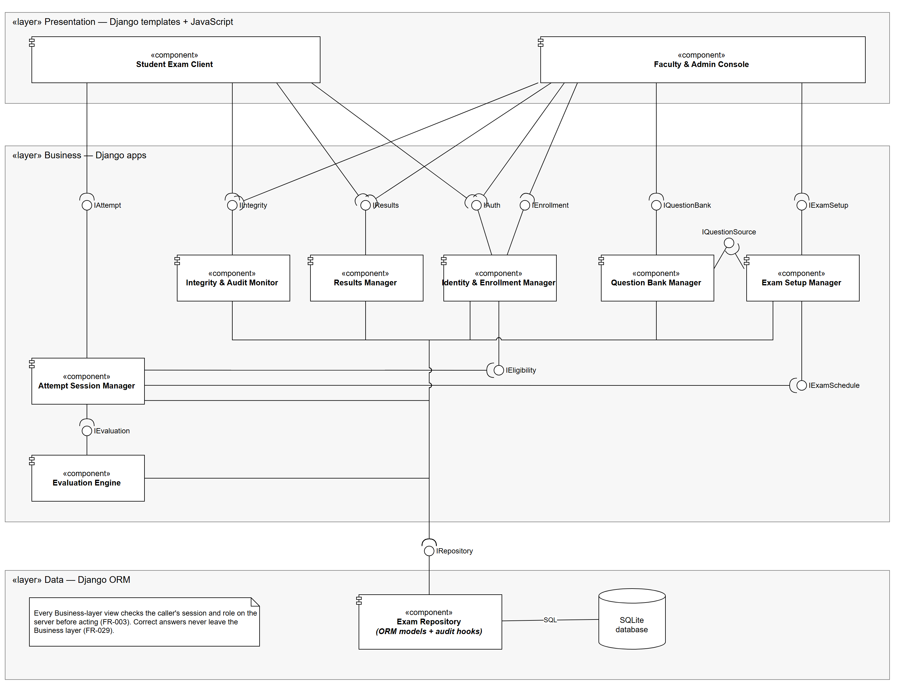

# Software Architecture Document — Online Examination Portal

**Course:** UE24CS341A — Software Engineering, PES University, Dept. of CSE\
**Project:** Online Examination System with Multiple-Choice Questions and Evaluation\
**Team:** Kshitij G Shettigar (Backend & Data) · Kartik Basavaraj Meti (Frontend & UX) · Komal S Sajja (QA & Docs)\
**Version:** 1.0 · **Date:** 2026-10-15

---

## 1. Purpose

This document records the architecture chosen for the Online Examination Portal: the architectural
style, the components and the interfaces between them, the technology each layer is built with,
and why. Every component traces to requirements in `Documents/SRS.md`.

## 2. Architecture selection

**We chose a Layered architecture for the Online Examination Portal.**

### 2.1 Styles compared

| Style | Fit for this system | Verdict |
|---|---|---|
| **Layered** (Presentation / Business / Data) | One deployable on one server; every rule (timer, eligibility, scoring) sits in one Business layer over one consistent database | **Chosen** |
| **Microservices** | Independent scaling is not needed at 200 concurrent attempts (NFR-001), and splitting attempts and scoring across services breaks the single transaction that submission needs (FR-020, FR-022) | Rejected — operational cost with no requirement that pays for it |
| **Client-Server** | Topologically true — browsers are the clients of one server — but says nothing about how the server is organised | Absorbed — the layered server *is* the server |

### 2.2 Reasons for the choice

1. **One consistent record for each attempt.** Starting an attempt, saving responses, submitting
   and scoring all read and write the same attempt row (FR-016, FR-019, FR-020, FR-022). In one
   Business layer over one database this is a single database transaction; across services it would
   need distributed coordination.
2. **The rules live on the server, behind one layer.** The timer is computed from the server clock
   (FR-017), eligibility from server time and enrollment (FR-015), and the answer key never leaves
   the server (FR-029). Layering puts all of these in the Business layer, where the browser cannot
   reach or alter them.

### 2.3 Security advantage

The Presentation layer has **no path to the database**. It can only call Business-layer interfaces,
and every Business-layer view checks the caller's session and role before acting (FR-003). The
Attempt Session Manager builds the question payload for the Student and leaves out the correct
option; the Presentation layer has no other route to it, so the key cannot leak through the page
(FR-029, verified by `IT_035`).

### 2.4 Performance benefit

Evaluation runs inside the server, on data already in the same database, as soon as the attempt is
submitted — no network hop between services. Scoring a 100-question attempt is one query for the
responses and one for the key, well within the 5-second target (NFR-002). Every page reads
through one repository with indexed foreign keys, which is what NFR-001 (95% of requests within
2 s at 200 concurrent attempts) is load-tested against.

---

## 3. Component diagram

Source: `Documents/diagrams/component_diagram.drawio` (open in draw.io). Notation: a ball is a
**provided** interface on the component that implements it; a socket is a **required** interface
on the component that calls it; a ball in a socket is an assembly connector.

### 3.1 Components

| Layer | Component | Responsibility | Requirements |
|---|---|---|---|
| Presentation | **Student Exam Client** | Dashboard, exam screen, server-driven countdown, question palette, autosave and focus-loss listeners, scorecard | FR-014, FR-017, FR-018, FR-019, FR-027, FR-028 |
| Presentation | **Faculty & Admin Console** | Course and enrollment screens, question editor, exam setup and scheduling, results publishing, integrity and audit views | FR-004, FR-005, FR-007–FR-013, FR-026 |
| Business | **Identity & Enrollment Manager** | Registration, sign-in, roles, account lockout, course enrollment, eligibility checks | FR-001–FR-006, FR-015, NFR-011, NFR-012 |
| Business | **Question Bank Manager** | Questions, options, tags, versioning of questions in use | FR-007, FR-008, FR-009 |
| Business | **Exam Setup Manager** | Examination details and policy, question selection, Draft/Published state, schedule window | FR-010–FR-013, NFR-010 |
| Business | **Attempt Session Manager** | Start attempt, server timer, answer-free paper payload, autosave, resume, submit and auto-submit | FR-015–FR-021, FR-029 |
| Business | **Evaluation Engine** | Scores a submitted attempt: positive and negative marks, total, percentage, pass/fail | FR-022, FR-023, FR-024 |
| Business | **Results Manager** | Withholds results until published; publish and unpublish; scorecards | FR-025, FR-026, FR-027 |
| Business | **Integrity & Audit Monitor** | Records focus-loss events; shows events and the audit trail to Faculty and Administrators | FR-028, FR-030 |
| Data | **Exam Repository** | Django ORM models over the database; writes the append-only audit entry on every change | FR-030, NFR-013 |

### 3.2 Interfaces

| Interface | Provided by | Required by | Kind |
|---|---|---|---|
| `IAuth` | Identity & Enrollment Mgr | Student Exam Client, Faculty & Admin Console | HTTP view |
| `IEnrollment` | Identity & Enrollment Mgr | Faculty & Admin Console | HTTP view |
| `IQuestionBank` | Question Bank Mgr | Faculty & Admin Console | HTTP view |
| `IExamSetup` | Exam Setup Mgr | Faculty & Admin Console | HTTP view |
| `IAttempt` | Attempt Session Mgr | Student Exam Client | HTTP view + JSON endpoints (autosave, timer) |
| `IIntegrity` | Integrity & Audit Monitor | Student Exam Client (report events), Faculty & Admin Console (view) | HTTP view + JSON endpoint |
| `IResults` | Results Mgr | Student Exam Client, Faculty & Admin Console | HTTP view |
| `IEligibility` | Identity & Enrollment Mgr | Attempt Session Mgr | In-process call |
| `IExamSchedule` | Exam Setup Mgr | Attempt Session Mgr | In-process call |
| `IQuestionSource` | Question Bank Mgr | Exam Setup Mgr | In-process call |
| `IEvaluation` | Evaluation Engine | Attempt Session Mgr | In-process call, same transaction as submission |
| `IRepository` | Exam Repository | all seven Business components | Django ORM |

Count: 7 Presentation→Business, 4 Business→Business, 1 Business→Data. Nothing in the Presentation
layer requires `IRepository`.

---

## 4. Technology stack

| Layer | Technology | Why |
|---|---|---|
| Presentation | Django templates, HTML/CSS, plain JavaScript (timer display, autosave every ≤ 5 s, `visibilitychange` listener) | Server-rendered pages keep the answer key server-side by default; no separate front-end build |
| Business | Django 5 (Python 3.12) — one Django app per Business component | Built-in authentication, password hashing (NFR-011), CSRF protection and ORM (NFR-013), and the admin site for course setup |
| Data | Django ORM over SQLite | Relational data — enrollment, attempts and scores — in one file database; the ORM keeps a later move to PostgreSQL a settings change |
| Automation | GitHub Actions — runs `python manage.py test` on every push and pull request | Course requirement (Sprint 1); a failing test blocks the merge |

**Auto-submission without a background worker.** An expired attempt is submitted and evaluated the
first time any request touches it, and a `close_expired_attempts` management command, run every
minute by cron, catches attempts that nobody touches (FR-020, FR-022). This avoids a task queue the
system does not otherwise need.

## 5. Deployment

One Linux virtual machine runs the Django application under Gunicorn behind Nginx (HTTPS), with the
SQLite database file on the same machine and its clock synchronised by NTP. Secrets such as
`SECRET_KEY` come from environment variables, never from the repository (NFR-014). After a restart
the service is back within 60 seconds and every attempt resumes from its stored start time and
saved responses (NFR-004).

## 6. Known limits

| Limit | Accepted because | Upgrade path |
|---|---|---|
| Single server — a single point of failure | The requirement is recovery (NFR-004), not zero downtime; autosave and server-held start times make every attempt resumable | Run two app servers behind the load balancer once the database moves to PostgreSQL |
| SQLite allows one writer at a time | 200 students autosaving every 5 s is about 40 short writes per second, which SQLite in WAL mode handles; NFR-001's load test confirms it | Switch the `DATABASES` setting to PostgreSQL; no code changes |
