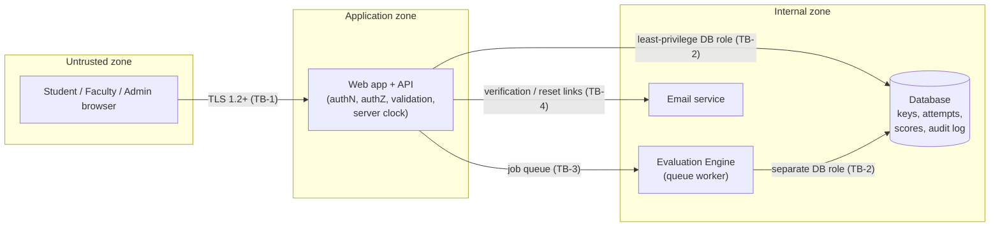

# Security Requirements Specification — Online Examination Portal

| | |
|---|---|
| **Document** | Security Requirements Specification (SecRS) |
| **Version** | 0.1 — Draft for M2 SRS integration |
| **Date** | 14 October 2026 |
| **Derived from** | `SRS_table.pdf`, `use_case_flow.md` (UC-1 … UC-7), `user_stories.md` (US-01 … US-06), `README.md` |
| **Companion to** | [`M1_REQUIREMENTS.md`](https://github.com/Kishi836/online-exam-portal/blob/docs/m1-deliverables/docs/01-requirements/M1_REQUIREMENTS.md) (security requirements seed, on the `docs/m1-deliverables` branch), future M2 SRS (IEEE Std 830-1998) |

---

## Table of Contents

1. [Introduction](#1-introduction)
2. [Security Objectives](#2-security-objectives)
3. [Assets](#3-assets)
4. [Actors and Trust Boundaries](#4-actors-and-trust-boundaries)
5. [Threat Analysis](#5-threat-analysis)
6. [Security Requirements](#6-security-requirements)
   - 6.1 Authentication & Identity (SEC-AUTH)
   - 6.2 Session Management (SEC-SES)
   - 6.3 Authorization & Access Control (SEC-AZ)
   - 6.4 Exam Integrity (SEC-INT)
   - 6.5 Data Protection (SEC-DATA)
   - 6.6 Input Handling & API Security (SEC-API)
   - 6.7 Audit & Accountability (SEC-AUD)
   - 6.8 Availability & Resilience (SEC-AVL)
   - 6.9 Privacy & Compliance (SEC-PRV)
7. [Traceability Matrix](#7-traceability-matrix)
8. [Verification Strategy](#8-verification-strategy)
9. [Open Issues and Inconsistencies in Source Documents](#9-open-issues-and-inconsistencies-in-source-documents)
10. [Assumptions and Out of Scope](#10-assumptions-and-out-of-scope)

---

## 1. Introduction

### 1.1 Purpose

This document specifies the security requirements for the Online Examination Portal: a system where Faculty author MCQ/MSQ questions, assemble and schedule papers, Students attempt them under a server-enforced timer, and an Evaluation Engine grades submissions automatically. It consolidates security obligations that are scattered across the SRS table, use case flows and user stories, and adds the requirements that those documents imply but do not state.

### 1.2 Scope

In scope: the web application, its API, the database, the evaluation engine, and the audit subsystem. See [Section 10](#10-assumptions-and-out-of-scope) for what is excluded.

### 1.3 How requirements are labelled

Every requirement has an ID of the form `SEC-<DOMAIN>-<NN>` and the following attributes:

| Attribute | Meaning |
|---|---|
| **Priority** | MoSCoW — **Must** / **Should** / **Could**. Where a requirement is backed by an SRS item, the SRS priority is inherited. |
| **Tier** | Product tier from the SRS table: **S** (small), **M** (medium), **L** (large). `S/M/L` means required in every tier. |
| **Basis** | **SRS** = restates or sharpens an existing SRS requirement. **Derived** = not in the SRS table but implied by a use case, user story or standard security practice. Derived requirements should be promoted into the M2 SRS (or consciously rejected). |
| **Trace** | Source requirement(s) — SRS IDs, UC-n, US-nn. |
| **Verification** | How we prove it: Test, Inspection, Analysis, Audit. |

### 1.4 Guiding principles

- **Never trust the client.** The browser is under the student's control. Anything the client says about time, focus, score, role or identity is a *claim* the server must verify or ignore.
- **Deny by default.** Access is granted by explicit rule, never by the absence of a rule.
- **The server is the single source of truth** for time, state, scoring and visibility.
- **Log and flag, a human decides.** Integrity monitoring is evidentiary (README; UC-6 A1). The system never silently invalidates a result.
- **Defence in depth.** Critical protections (answer-key secrecy, results gating, immutability) are enforced at more than one layer — API *and* data layer.

---

## 2. Security Objectives

| ID | Objective | Why it matters here |
|---|---|---|
| SO-1 | **Confidentiality** of answer keys, unpublished results, credentials and student PII | A leaked key or early result destroys the exam's value. |
| SO-2 | **Integrity** of questions, attempts, scores and the audit trail | A score is a record that affects a student's academic standing. |
| SO-3 | **Availability** during the exam window | An outage mid-exam harms every enrolled student at once. |
| SO-4 | **Accountability** — every state change attributable to an actor | Disputes (re-evaluation, flagged attempts) need evidence. |
| SO-5 | **Exam fairness** — equal, time-bounded, single-session attempts | The core promise of an online exam. |
| SO-6 | **Least privilege** between Student, Faculty, Admin and the Evaluation Engine | Limits blast radius of a compromised account. |

---

## 3. Assets

| Asset | Examples | Confidentiality | Integrity | Availability |
|---|---|:-:|:-:|:-:|
| Answer keys & explanations | Correct options per question | **High** | **High** | Medium |
| Question bank | Stems, options, tags, versions | High (pre-exam) | **High** | Medium |
| Exam definitions | Paper composition, marks, policy, window | Medium | **High** | High |
| Attempts & responses | Autosaved answers, timestamps, seeds | Medium | **High** | **High** |
| Scorecards & results | Scores, pass/fail, itemized marks | **High** (until published) | **High** | Medium |
| Student PII | Name, institutional email, roll number | High | Medium | Medium |
| Credentials & tokens | Password hashes, session tokens, reset/verification tokens | **High** | **High** | Medium |
| Audit log | Mutations, overrides, integrity events | Medium | **High** | Medium |
| Integrity evidence | Focus-loss events, flags | Medium | **High** | Medium |

---

## 4. Actors and Trust Boundaries

### 4.1 Actors

| Actor | Trust level | Notes |
|---|---|---|
| **Student** | Untrusted for exam integrity | Highest-motivation adversary: wants a better score. Controls the browser. |
| **Faculty** | Trusted within owned/mapped courses | Can see keys for their own courses; must not reach other courses' data. |
| **Administrator** | Highly privileged | Rule owner (UC-6); can override; every action is audited. |
| **Evaluation Engine** (`«system»`) | Trusted internal service | Needs read access to keys and attempts, write access to scorecards — nothing more. |
| **External attacker** | Untrusted | Unauthenticated; credential stuffing, injection, scraping. |

### 4.2 Trust boundaries

| Boundary | Crossing | Key control |
|---|---|---|
| **TB-1** | Browser → API | TLS, authentication, CSRF, input validation, rate limiting |
| **TB-2** | App/Engine → Database | Separate DB roles; audit table is INSERT-only; keys readable only by engine and authorized faculty paths |
| **TB-3** | API → Evaluation Engine | Only submitted, frozen attempts are enqueued; engine is idempotent |
| **TB-4** | System → Email provider | Tokens are single-use, short-lived, never logged |

---

## 5. Threat Analysis

STRIDE-style analysis of the threats most relevant to this system. "Mitigated by" points to requirements in Section 6.

| ID | Threat | Category | Actor | Target | Mitigated by |
|---|---|---|---|---|---|
| T-01 | Student inspects network responses / page source to read correct answers | Information disclosure | Student | Answer keys | SEC-INT-03, SEC-DATA-01 |
| T-02 | Student changes the device clock or freezes the client timer to gain time | Tampering | Student | Timer | SEC-INT-01 |
| T-03 | Student logs in on a second device to share the exam with a helper | Spoofing / fairness | Student | Session | SEC-SES-03 |
| T-04 | Student suppresses focus-loss events (disables JS handlers, uses a second device) | Repudiation / tampering | Student | Integrity evidence | SEC-INT-05, SEC-INT-06 (evidence only; residual risk accepted) |
| T-05 | Student tampers with a request to change another student's answers or read their scorecard (IDOR) | Elevation / info disclosure | Student | Attempts, scorecards | SEC-AZ-02 |
| T-06 | Student calls results endpoints directly before publication | Information disclosure | Student | Scorecards | SEC-AZ-04 |
| T-07 | Self-registration used to obtain Faculty/Admin role (mass assignment, tampered role field) | Elevation of privilege | External attacker / Student | RBAC | SEC-AUTH-03, SEC-AZ-01 |
| T-08 | Credential stuffing / brute force against login | Spoofing | External attacker | Accounts | SEC-AUTH-05, SEC-API-06 |
| T-09 | Attacker deliberately triggers account lockout on a victim during the exam window | Denial of service | Student / attacker | Availability | SEC-AUTH-06 |
| T-10 | Stored XSS through a malicious question stem, option, or code snippet executed in every student's browser | Tampering / info disclosure | Faculty (malicious or compromised) | All students | SEC-API-03 |
| T-11 | Malicious bulk-import file (CSV formula injection, oversize, zip/JSON bomb, hostile image) | Tampering / DoS | Faculty / attacker | Server, other users | SEC-API-04, SEC-API-05 |
| T-12 | Question edited after exam is published/attempted, silently changing what students answered | Tampering | Faculty | Question bank, scores | SEC-DATA-02 |
| T-13 | Score changed without trace (insider) | Repudiation | Faculty / Admin | Scorecards | SEC-AUD-01, SEC-AUD-03 |
| T-14 | Double-submit / race conditions create two attempts or let late answers slip in after expiry | Tampering | Student | Attempts | SEC-INT-02, SEC-INT-07 |
| T-15 | Flood of autosave calls or exam-start surge overwhelms the server | Denial of service | Student / crowd | Availability | SEC-INT-08, SEC-AVL-04 |
| T-16 | Password reset / verification token guessed, reused, or intercepted | Spoofing | External attacker | Accounts | SEC-AUTH-04, SEC-AUTH-07 |
| T-17 | Someone registers using another student's roll number / institutional identity | Spoofing | Student / attacker | Identity | SEC-AUTH-04, SEC-AUTH-08 |
| T-18 | Clickjacking or embedding of the exam page to assist cheating or phishing | Spoofing | Attacker | Exam UI | SEC-API-07 |

---

## 6. Security Requirements

### 6.1 Authentication & Identity (SEC-AUTH)

| ID | Requirement | Priority | Tier | Basis | Trace | Verification |
|---|---|---|---|---|---|---|
| **SEC-AUTH-01** | Passwords SHALL be stored only as salted hashes using an adaptive algorithm (Argon2id preferred; bcrypt or scrypt acceptable) with a per-user salt. Plaintext or reversibly encrypted passwords SHALL never be stored or logged. | Must | S/M/L | SRS | SRS-AUTH01, AUTH03 | Inspection, Test |
| **SEC-AUTH-02** | Passwords SHALL be at least 8 characters, and SHALL be rejected if they appear on a common/breached-password blocklist. Composition rules (forced symbols, etc.) are not required. | Must | S/M/L | Derived | SRS-AUTH01 | Test |
| **SEC-AUTH-03** | A user's role SHALL be assigned server-side only. The self-registration endpoint SHALL NOT accept a role parameter, and self-registration SHALL create Student accounts only. Faculty and Administrator accounts SHALL be provisioned by an Administrator (or seeded at deployment). | Must | S/M/L | Derived | SRS-AUTH01, AUTH06 | Test, Inspection |
| **SEC-AUTH-04** | Account activation SHALL require clicking a verification link sent to the institutional email. The token SHALL be single-use, at least 128 bits of entropy, stored hashed, and expire (proposed: 24 hours). Registration SHALL reject emails outside the configured institutional domain allowlist. *In Tier S, where SRS-AUTH02 is not required, the domain allowlist alone SHALL still apply and the residual risk of unverified ownership SHALL be documented.* | Should (M/L) · Must (domain allowlist, all tiers) | M/L (S: allowlist only) | SRS | SRS-AUTH02 | Integration Test |
| **SEC-AUTH-05** | After 5 failed login attempts within 15 minutes the account SHALL be locked for 15 minutes. Login responses SHALL be identical for "unknown email" and "wrong password" (no user enumeration), and response time SHOULD NOT reveal which case occurred. | Must | S/M/L | SRS | SRS-AUTH04 | Security / Automated Test |
| **SEC-AUTH-06** | Lockout abuse SHALL be mitigated: failed-attempt counting SHALL also be throttled per source IP, and an Administrator SHALL be able to unlock an account. Locked-account events SHALL be audited. *(Reason: an attacker could otherwise lock a student out of an exam by deliberately failing logins.)* | Should | S/M/L | Derived | SRS-AUTH04 | Test |
| **SEC-AUTH-07** | Password reset tokens SHALL be single-use, at least 128 bits of entropy, stored hashed, and expire in 15 minutes. Requesting a new token SHALL invalidate older ones. A successful reset SHALL revoke all active sessions for that account. The reset-request response SHALL be identical whether or not the email exists. | Must | S/M/L | SRS | SRS-AUTH05 | Functional / Security Test |
| **SEC-AUTH-08** | Roll Number SHALL be unique per account, and Roll Number + institutional email SHOULD be validated against an institutional roster (for example the enrollment CSV used in SRS-CRS-05) so that a student cannot register as someone else. | Should | M/L | Derived | SRS-AUTH01, CRS-05 | Test |

### 6.2 Session Management (SEC-SES)

| ID | Requirement | Priority | Tier | Basis | Trace | Verification |
|---|---|---|---|---|---|---|
| **SEC-SES-01** | Session identifiers SHALL be unpredictable (at least 128 bits of CSPRNG output). Session cookies SHALL be `HttpOnly`, `Secure`, and `SameSite=Lax` or stricter. Session data SHALL NOT be readable or forgeable by the client (server-side store or signed + encrypted token). | Must | S/M/L | SRS | SRS-AUTH03 | Inspection, Test |
| **SEC-SES-02** | Sessions SHALL have an idle timeout and an absolute lifetime. During an active exam attempt, autosave traffic SHALL count as activity so an idle timeout cannot terminate an attempt mid-exam. | Must | S/M/L | Derived | SRS-AUTH03, ATT-05 | Test |
| **SEC-SES-03** | A Student SHALL have at most one active session. A new login SHALL atomically invalidate the previous session; the old session's next request SHALL receive an authentication error that explains it was signed out by a newer login. Concurrent logins (race) SHALL leave exactly one valid session. An in-progress attempt SHALL continue in the new session with timer unaffected. | Must | S/M/L | SRS | SRS-AUTH07, UC-1 A2 | Concurrency Test |
| **SEC-SES-04** | The session identifier SHALL be rotated on login and on any privilege change. Logout SHALL destroy the server-side session. | Must | S/M/L | Derived | SRS-AUTH03 | Test |
| **SEC-SES-05** | All state-changing requests SHALL be protected against CSRF (anti-CSRF token and/or strict `SameSite` + Origin check). | Must | S/M/L | Derived | SRS-AUTH03 | Security Test |
| **SEC-SES-06** | All traffic SHALL use TLS 1.2 or higher with HSTS. Plain HTTP SHALL redirect or be refused. | Must | S/M/L | Derived | SRS-AUTH03 | Inspection, Scan |

### 6.3 Authorization & Access Control (SEC-AZ)

| ID | Requirement | Priority | Tier | Basis | Trace | Verification |
|---|---|---|---|---|---|---|
| **SEC-AZ-01** | RBAC (Student, Faculty, Admin) SHALL be enforced on the server for every endpoint, deny-by-default. UI hiding of controls SHALL NOT be treated as access control. | Must | S/M/L | SRS | SRS-AUTH06 | Security Audit / Test |
| **SEC-AZ-02** | Object-level authorization SHALL be enforced on every resource lookup: a Student may read/write only their own attempts and scorecards; Faculty may access questions, exams and results only for courses they are mapped to; direct object ID manipulation SHALL return 403/404. | Must | S/M/L | Derived | SRS-AUTH06, CRS-02, CRS-04 | Security Test (IDOR) |
| **SEC-AZ-03** | Exam visibility and attempt eligibility SHALL be gated server-side by active course enrollment, and archived (soft-deleted) courses SHALL NOT allow new attempts. | Must | S/M/L | SRS | SRS-CRS-01, CRS-03, CRS-04, SCH-04 | Integration Test |
| **SEC-AZ-04** | Results SHALL be hidden from a Student until Faculty explicitly publishes them. The gate SHALL be enforced at the API and data-query layer and SHALL cover side channels: scorecard endpoints, status/"evaluated" flags that leak pass/fail, notifications, and cohort statistics. | Must | S/M/L | SRS | SRS-RES-01, UC-3 A1, UC-7 | Access Control Test |
| **SEC-AZ-05** | Review of correct answers/explanations by a Student SHALL be available only after publication and only if Faculty enabled post-exam review (UC-7 step 4). | Must | S/M/L | Derived | US-02, UC-7 | Access Control Test |
| **SEC-AZ-06** | Authorization denials SHALL be logged (actor, resource, action, time). Repeated denials from one account SHOULD raise an alert. | Should | M/L | Derived | SRS-ADM-01 | Test |

### 6.4 Exam Integrity (SEC-INT)

| ID | Requirement | Priority | Tier | Basis | Trace | Verification |
|---|---|---|---|---|---|---|
| **SEC-INT-01** | The server SHALL be the sole authority for time. Attempt start, remaining time, expiry and submission cutoff SHALL be computed from an NTP-synchronised server clock. The client timer is display-only; client-supplied timestamps SHALL be ignored for any decision. Responses arriving after server expiry SHALL be rejected, except an autosave demonstrably received before the deadline. | Must | S/M/L | SRS | SRS-ATT-01, ATT-02, ATT-07, SCH-04 | Security / Unit Test |
| **SEC-INT-02** | Attempt creation SHALL be atomic and idempotent: concurrent "start exam" requests (double-click, two tabs) SHALL yield one attempt. The attempt record SHALL be created and server-stamped *before* any question payload is delivered. Eligibility (window, enrollment, attempt history) SHALL be checked inside the same transaction. | Must | S/M/L | SRS | SRS-ATT-01, SCH-04 | Sequence / Concurrency Test |
| **SEC-INT-03** | Correct options, answer keys and explanations SHALL NOT appear in any candidate-facing payload — question JSON, API errors, HTML source, WebSocket/SSE messages, or client-visible logs. Candidate-facing responses SHALL be produced by allowlist serializers (explicitly listing fields to send), not by serializing the full database object and removing fields. | Must | S/M/L | SRS | SRS-INT-07, US-03 | Payload Inspection, Automated Test |
| **SEC-INT-04** | Question and option shuffling SHALL be seeded and stored server-side per attempt. The client SHALL submit opaque per-attempt option identifiers (not display positions or global option IDs), and the server SHALL map them back. Resuming an attempt SHALL reproduce the same order. | Must | S/M/L | SRS | SRS-ATT-10, UC-1 A2/A3 | Algorithmic Test |
| **SEC-INT-05** | Focus-loss / tab-switch / full-screen-exit events SHALL be reported to the server and stamped with server time. The violation counter SHALL be kept server-side (a page reload SHALL NOT reset it). Events from the client SHALL be treated as *advisory evidence*, not proof: the system records and flags; it never auto-invalidates a score. | Must | S/M/L | SRS | SRS-INT-01, US-06, UC-6 | Event Capture Test |
| **SEC-INT-06** | The violation policy (warn on 1st and 2nd, then auto-submit **or** flag as "Suspicious" on the 3rd) SHALL be configurable per exam, enforced server-side, and every flag SHALL carry its reason and the full event timeline. A human reviewer SHALL be able to clear or uphold any flag, and that decision SHALL be audited. | Must | S/M/L | Derived | US-06, UC-6, UC-1 E2 | Test |
| **SEC-INT-07** | After submission, the response set SHALL be frozen: no endpoint SHALL modify responses or reopen the attempt. Submission SHALL be idempotent. A late write racing with expiry SHALL be resolved by server timestamp. | Must | S/M/L | Derived | UC-2, SRS-ATT-07 | Concurrency Test |
| **SEC-INT-08** | Autosave endpoints SHALL enforce a maximum request size and a per-attempt rate limit (the SRS interval is ≤ 5 s, so a limit of a few multiples of that is reasonable). Excess requests SHALL receive 429 without corrupting stored state. | Must | S/M/L | Derived | SRS-ATT-05 | Resilience / API Test |
| **SEC-INT-09** | The Evaluation Engine SHALL use only the question and answer-key **version pinned to the attempt**, never the "latest" version. | Must | S/M/L | Derived | SRS-QB-05, EVL-01 | Database Integrity Test |

### 6.5 Data Protection (SEC-DATA)

| ID | Requirement | Priority | Tier | Basis | Trace | Verification |
|---|---|---|---|---|---|---|
| **SEC-DATA-01** | Answer keys SHALL be readable only by (a) the Evaluation Engine and (b) Faculty for courses they are mapped to. The Student-facing service role SHALL have no read privilege on key columns/tables. | Must | S/M/L | Derived | SRS-INT-07, US-03 | Inspection, Test |
| **SEC-DATA-02** | Questions attached to a published or attempted exam SHALL be immutable. Edits SHALL create a new version (copy-on-write); the locked version SHALL be protected at the database level (constraint/trigger/permission), not only in application code. | Must | S/M/L | SRS | SRS-QB-05 | Database Integrity Test |
| **SEC-DATA-03** | After results are published, the answer key for that paper SHALL be locked (UC-7). Any later key correction SHALL require an authorized Faculty/Admin action with a mandatory reason, SHALL trigger audited bulk re-evaluation of affected attempts, and SHALL notify affected students. *(See Open Issue OI-03.)* | Must (M/L) | M/L | SRS | SRS-EVL-07, UC-7 | Integration Test |
| **SEC-DATA-04** | Databases, backups and file storage SHOULD be encrypted at rest. | Should | M/L | Derived | — | Inspection |
| **SEC-DATA-05** | Secrets (DB credentials, signing keys, email provider keys) SHALL NOT be committed to the repository or shipped to the client; they SHALL come from environment variables or a secrets manager and be rotatable. | Must | S/M/L | Derived | — | Inspection (secret scan) |
| **SEC-DATA-06** | Data minimisation: only Name, Institutional Email, Roll Number and password hash are collected at registration. PII SHALL be masked or omitted in application logs. Faculty SHALL see PII only for students enrolled in their courses. | Must | S/M/L | Derived | SRS-AUTH01 | Inspection, Test |
| **SEC-DATA-07** | Dependencies SHALL be tracked and scanned for known vulnerabilities, and updated on a defined cadence. | Should | S/M/L | Derived | — | Automated scan (CI) |

### 6.6 Input Handling & API Security (SEC-API)

| ID | Requirement | Priority | Tier | Basis | Trace | Verification |
|---|---|---|---|---|---|---|
| **SEC-API-01** | All inputs SHALL be validated server-side against a schema (type, length, range, enum); unknown fields SHALL be rejected (prevents mass assignment). This includes: 2–6 options and ≥ 1 correct for MCQ, ≥ 2 correct for MSQ, valid difficulty enum, non-negative marks, marks sum = declared total before publish. | Must | S/M/L | SRS | SRS-QB-01, QB-02, QB-04, EX-04, EX-05 | Data Validation / Unit Test |
| **SEC-API-02** | All database access SHALL use parameterised queries or an ORM; string-concatenated SQL is prohibited. This applies in particular to the question search/filter engine (Course, Topic, Difficulty, Stem keywords). | Must | S/M/L | Derived | SRS-QB-07 | SAST, Security Test |
| **SEC-API-03** | Rich text, code snippets and option text SHALL be sanitised with an allowlist HTML sanitiser on save, and context-encoded on render. Code snippets SHALL be rendered as text, never as HTML. A Content-Security-Policy SHALL block inline script execution as a second line of defence. | Must | S/M/L | Derived | US-03, UC-4 | Security Test (XSS) |
| **SEC-API-04** | Image uploads SHALL be validated by content (magic bytes), not by extension or client MIME type; limited in size and dimensions; re-encoded; stripped of metadata; stored under random names; and served with `X-Content-Type-Options: nosniff`. Unsanitised SVG SHALL NOT be accepted. | Must | S/M/L | Derived | US-03, UC-4 | Security Test |
| **SEC-API-05** | Bulk imports (question CSV/JSON and enrollment CSV) SHALL enforce maximum file size, row count and JSON nesting depth; use a strict schema; neutralise spreadsheet formula injection (cells beginning `=`, `+`, `-`, `@`) in any data echoed into exports or error reports; and never echo unsanitised content in error logs. Enrollment import SHALL be all-or-nothing with line-level error logs. | Must (enrollment: Should) | S/M/L (enrollment: M/L) | SRS | SRS-CRS-05, US-03, UC-4 A1 | System Test |
| **SEC-API-06** | Rate limiting SHALL be applied to login, registration, verification, reset-request and all API endpoints (per account and per IP), returning 429 with `Retry-After`. | Must | S/M/L | Derived | SRS-AUTH04 | Test |
| **SEC-API-07** | Responses SHALL include security headers: `Content-Security-Policy` (including `frame-ancestors 'none'`), `X-Content-Type-Options: nosniff`, `Referrer-Policy`, and `Strict-Transport-Security`. CORS SHALL use an explicit origin allowlist. | Must | S/M/L | Derived | — | Automated scan |
| **SEC-API-08** | Error responses SHALL be generic to the client (no stack traces, SQL errors, internal paths, or version banners); details go to server logs only. | Must | S/M/L | Derived | — | Inspection, Test |

### 6.7 Audit & Accountability (SEC-AUD)

| ID | Requirement | Priority | Tier | Basis | Trace | Verification |
|---|---|---|---|---|---|---|
| **SEC-AUD-01** | The system SHALL keep an immutable, append-only log of all state mutations and score overrides. The application's database role SHALL have INSERT-only privilege on the audit store. Entries SHOULD be hash-chained so tampering is detectable. | Must (chaining: Should) | S/M/L | SRS | SRS-ADM-01 | Security Audit |
| **SEC-AUD-02** | Each audit entry SHALL record: actor ID and role, action, target object and ID, before/after values (or a diff), server timestamp, source IP, and request/correlation ID. | Must | S/M/L | SRS | SRS-ADM-01 | Inspection |
| **SEC-AUD-03** | Score overrides SHALL be permitted only to authorized roles, SHALL require a written reason, and SHALL preserve the original computed score. | Must | S/M/L | SRS | SRS-ADM-01 | Test |
| **SEC-AUD-04** | The following security events SHALL be logged: login success/failure, lockout and unlock, password reset and verification, role changes, session invalidation by a second login, authorization denials, focus-loss events and flags, flag review decisions, results publication, answer-key changes, and re-evaluations. | Must | S/M/L | Derived | UC-6, UC-7, SRS-AUTH04/07 | Test |
| **SEC-AUD-05** | Logs SHALL NOT contain passwords, session tokens, reset/verification tokens, or answer keys. | Must | S/M/L | Derived | — | Inspection (log review) |
| **SEC-AUD-06** | Audit log read access SHALL be restricted to Administrators. Retention period SHALL be defined (see SEC-PRV-02). | Must | S/M/L | Derived | SRS-ADM-01 | Test |
| **SEC-AUD-07** | All timestamps SHALL come from the NTP-synchronised server clock. | Must | S/M/L | Derived | SRS-SCH-04 | Inspection |

### 6.8 Availability & Resilience (SEC-AVL)

| ID | Requirement | Priority | Tier | Basis | Trace | Verification |
|---|---|---|---|---|---|---|
| **SEC-AVL-01** | Autosaved responses SHALL be durably persisted (surviving an application restart). Resuming an interrupted attempt SHALL restore saved state and the server-calculated remaining time. | Must | S/M/L | SRS | SRS-ATT-05, ATT-07, ATT-08, UC-1 A2 | Fault-Injection Test |
| **SEC-AVL-02** | Evaluation SHALL be deterministic and idempotent: running it twice on the same attempt yields the same scorecard and creates no duplicates. Failed jobs SHALL be retried with backoff; a failure on one question (for example a missing key) SHALL flag an "Evaluation Error" without blocking the rest. | Must | S/M/L | SRS | SRS-EVL-01, EVL-02, UC-3 E1 | Unit Test |
| **SEC-AVL-03** | The Evaluation Engine SHALL run under a dedicated least-privilege database role: read submitted attempts and keys, write scorecards, nothing else. | Must | S/M/L | Derived | SRS-EVL-01 | Inspection |
| **SEC-AVL-04** | The system SHOULD withstand the exam-start surge (all students starting at the window opening) through connection limits, queueing and caching of non-sensitive exam metadata. Capacity targets SHALL be defined in M2 *(TBD)*. | Should | M/L | Derived | SRS-SCH-04, EVL-06 | Load Test |
| **SEC-AVL-05** | Backups SHALL be taken on a defined schedule and restore SHALL be tested. RPO/RTO targets SHALL be defined in M2 *(TBD)*. | Should | M/L | Derived | — | Inspection, Drill |
| **SEC-AVL-06** | An Administrator or Faculty SHOULD be able to extend an exam window (globally or per student) after a platform incident, with a mandatory reason and audit entry. | Should | M/L | Derived | SRS-SCH-01, UC-5 | Test |

### 6.9 Privacy & Compliance (SEC-PRV)

| ID | Requirement | Priority | Tier | Basis | Trace | Verification |
|---|---|---|---|---|---|---|
| **SEC-PRV-01** | Students SHALL be told, before starting an attempt, which integrity signals are monitored (focus loss, tab switch, full-screen exit) and how they may be used. Monitoring SHALL be limited to the signals listed in this document. | Must | S/M/L | Derived | US-06, UC-6 | Inspection |
| **SEC-PRV-02** | Retention periods for attempts, scorecards, integrity events and audit logs SHALL be defined, and expired data SHALL be deleted or anonymised on schedule. | Should | M/L | Derived | SRS-ADM-01 | Inspection |
| **SEC-PRV-03** | The system SHALL comply with the data-protection regulations applicable to the deploying institution (for example India's DPDP Act 2023, or FERPA/GDPR where relevant). The applicable regime SHALL be confirmed against the [PRD](https://github.com/Kishi836/online-exam-portal/blob/docs/m1-deliverables/PRD_01_Online_Exam_Portal.md) compliance section. | Should | M/L | Derived | PRD | Analysis |

---

## 7. Traceability Matrix

Maps each security-relevant SRS requirement to the security requirements that implement or sharpen it. SRS items with no row have no direct security implication beyond the general controls (SEC-API-01/08).

| SRS ID | Summary | Security requirements |
|---|---|---|
| SRS-AUTH01 | Self-registration (Name, Email, Roll No., Password) | SEC-AUTH-01, 02, 03, 08, SEC-DATA-06 |
| SRS-AUTH02 | Email verification link | SEC-AUTH-04 |
| SRS-AUTH03 | Email/password auth, encrypted sessions | SEC-AUTH-01, SEC-SES-01, 02, 04, 05, 06 |
| SRS-AUTH04 | Lockout: 5 failures / 15 min | SEC-AUTH-05, 06, SEC-API-06 |
| SRS-AUTH05 | Password reset, single-use 15-min token | SEC-AUTH-07 |
| SRS-AUTH06 | RBAC per endpoint | SEC-AZ-01, 02, SEC-AUTH-03 |
| SRS-AUTH07 | Single active session per Student | SEC-SES-03 |
| SRS-CRS-01 | Course master, soft archive | SEC-AZ-03 |
| SRS-CRS-02 | Faculty–Course mapping | SEC-AZ-02 |
| SRS-CRS-03 | Student enrollment | SEC-AZ-03 |
| SRS-CRS-04 | Exam gating by enrollment | SEC-AZ-02, 03 |
| SRS-CRS-05 | All-or-nothing CSV enrollment import | SEC-API-05, SEC-AUTH-08 |
| SRS-QB-01 | MCQ authoring | SEC-API-01, 03, 04 |
| SRS-QB-02 | MSQ authoring | SEC-API-01, 03 |
| SRS-QB-04 | Question metadata | SEC-API-01 |
| SRS-QB-05 | Copy-on-write immutability | SEC-DATA-02, SEC-INT-09 |
| SRS-QB-07 | Search/filter engine | SEC-API-02, SEC-AZ-02 |
| SRS-EX-02 | Manual question attachment | SEC-AZ-02 |
| SRS-EX-04 | Marks-sum validation lock | SEC-API-01 |
| SRS-EX-05 | Exam policy (negative marking, shuffle, pass mark) | SEC-API-01, SEC-INT-04 |
| SRS-SCH-01 | Scheduling window | SEC-INT-01, SEC-AVL-06 |
| SRS-SCH-04 | NTP-based eligibility gating | SEC-INT-01, 02, SEC-AZ-03, SEC-AUD-07 |
| SRS-ATT-01 | Server-stamped attempt creation | SEC-INT-01, 02 |
| SRS-ATT-02 | Server-calculated timer | SEC-INT-01 |
| SRS-ATT-05 | Autosave ≤ 5 s | SEC-INT-08, SEC-AVL-01, SEC-SES-02 |
| SRS-ATT-07 | Auto-submit on expiry | SEC-INT-01, 07, SEC-AVL-01 |
| SRS-ATT-08 | Resume with server-restored time | SEC-AVL-01, SEC-SES-03 |
| SRS-ATT-10 | Per-student seed, persistence | SEC-INT-04 |
| SRS-EVL-01 | Deterministic automatic scoring | SEC-AVL-02, 03, SEC-INT-09 |
| SRS-EVL-02 | Positive/negative marks | SEC-AVL-02 |
| SRS-EVL-06 | 100-question paper ≤ 5 s | SEC-AVL-04 (see OI-02) |
| SRS-EVL-07 | Answer-key update + re-evaluation | SEC-DATA-03 (see OI-03) |
| SRS-RES-01 | Results hidden until publication | SEC-AZ-04, 05 |
| SRS-RES-03 | Student scorecard | SEC-AZ-02, 04 |
| SRS-INT-01 | Focus-loss capture, server time | SEC-INT-05, 06, SEC-PRV-01 |
| SRS-INT-07 | No keys in candidate payloads | SEC-INT-03, SEC-DATA-01 |
| SRS-ADM-01 | Immutable audit log | SEC-AUD-01 – 07 |

### 7.1 Coverage of use cases and user stories

| Source | Security requirements |
|---|---|
| UC-1 Attempt Timed Exam | SEC-INT-01 – 08, SEC-SES-03, SEC-AVL-01 |
| UC-2 Submit Exam | SEC-INT-07, SEC-AUD-04 |
| UC-3 Automated Evaluation | SEC-AVL-02, 03, SEC-INT-09 |
| UC-4 Create & Configure Question | SEC-API-01 – 05, SEC-DATA-02 |
| UC-5 Configure & Schedule Exam | SEC-API-01, SEC-AZ-02, SEC-AVL-06 |
| UC-6 Monitor Focus Loss | SEC-INT-05, 06, SEC-AUD-04, SEC-PRV-01 |
| UC-7 Publish Results | SEC-AZ-04, 05, SEC-DATA-03, SEC-AUD-04 |
| US-01 Timed session | SEC-INT-01, SEC-AVL-01 |
| US-02 Result & score breakdown | SEC-AZ-04, 05 (OI-01, resolved) |
| US-03 Question bank | SEC-API-01 – 05, SEC-DATA-01, 02 |
| US-04 Test configuration | SEC-API-01, SEC-INT-04 |
| US-05 Evaluation engine | SEC-AVL-02, 03 (see OI-02) |
| US-06 Anti-cheating tracker | SEC-INT-05, 06, SEC-PRV-01 |

---

## 8. Verification Strategy

| Activity | Covers | When |
|---|---|---|
| **Static analysis (SAST) + secret scanning** | SEC-API-02, SEC-DATA-05, SEC-AUD-05 | Every commit (CI) |
| **Dependency vulnerability scan** | SEC-DATA-07 | Every build |
| **Unit tests** — scoring, timer, validation, lockout counters | SEC-INT-01, SEC-AUTH-05, SEC-AVL-02, SEC-API-01 | Every commit |
| **Concurrency tests** — double login, double start, submit-vs-expiry race | SEC-SES-03, SEC-INT-02, SEC-INT-07 | Per sprint |
| **Payload inspection tests** — automated check that no candidate response contains key fields | SEC-INT-03 | Every build |
| **Authorization matrix tests** — every endpoint × every role, plus IDOR probes | SEC-AZ-01, 02, 04 | Per sprint |
| **DAST scan** (e.g., OWASP ZAP) | SEC-API-03, 07, 08, SEC-SES-05 | Pre-release |
| **Fault-injection** — kill app/network mid-attempt | SEC-AVL-01 | Pre-release |
| **Database integrity tests** — attempt to UPDATE a locked question version; attempt UPDATE/DELETE on audit table | SEC-DATA-02, SEC-AUD-01 | Per sprint |
| **Manual penetration review** | Whole system | Before final demonstration (M5) |

**Suggested baseline:** OWASP ASVS (v4.0) Level 2 for verification depth, and the OWASP Top 10 as a checklist for the DAST/penetration passes.

---

## 9. Open Issues and Inconsistencies in Source Documents

While deriving these requirements, the following conflicts and gaps were found across the source documents. Each needs a decision before the M2 SRS is baselined.

| ID | Issue | Where | Security impact | Recommendation |
|---|---|---|---|---|
| **OI-01** | **Result visibility timing.** US-02 says students see results "immediately after submitting". SRS-RES-01 and UC-7 say results stay hidden until Faculty explicitly publishes. | US-02 vs SRS-RES-01, UC-3 A1, UC-7 | High — determines whether results are gated at all. | Treat publication-gated release as the rule. Reword US-02 to "once published", or add an explicit per-exam *instant release* policy that Faculty can switch on. **Resolved 14 Oct 2026:** publication-gated release only. US-02 reworded; no instant-release policy. |
| **OI-02** | **Evaluation time target.** US-05 / UC-3 say ≤ 2 s per submission; SRS-EVL-06 says ≤ 5 s for a 100-question paper. | US-05, UC-3 step 7 vs SRS-EVL-06 | Low — but the acceptance test must be unambiguous. | Pick one metric (suggest per-submission, per paper size) and update the other documents. |
| **OI-03** | **Answer-key lock vs. key correction.** UC-7 locks the key at publication; SRS-EVL-07 allows post-exam key updates with bulk re-evaluation. | UC-7 step 6 vs SRS-EVL-07 | Medium — a lock that can be bypassed silently is not a lock. | Define the correction path (SEC-DATA-03): authorized, reasoned, audited, with re-evaluation and student notification. |
| **OI-04** | **Focus-loss enforcement is not in the SRS.** SRS-INT-01 only *captures* events. The warn → auto-submit/flag policy (US-06, UC-6) has no SRS entry, and the SRS has no INT-02 … INT-06. | SRS-INT-01 vs US-06, UC-6 | Medium — the behaviour users were promised has no requirement or test behind it. | Add SRS entries for the warning dialogs, the 3-strike policy, the flag, and the reviewer dashboard (SEC-INT-05/06). |
| **OI-05** | **Who owns the violation policy?** US-06 and UC-6 name the Administrator as rule owner; UC-1 E2 and UC-6 step 4 say "per faculty configuration". | UC-1 E2, UC-6, US-06 | Low–Medium — unclear ownership means unclear authorization. | Decide: Admin sets a global default; Faculty may override per exam (or not). Reflect in RBAC. |
| **OI-06** | **Faculty/Admin onboarding undefined.** SRS-AUTH01 describes self-registration capturing a roll number (a student attribute). No requirement says how Faculty or Admin accounts are created. | SRS-AUTH01 / AUTH06 | **High** — an open path to privilege escalation. | Adopt SEC-AUTH-03: self-registration creates Students only; staff are provisioned by Admin. **Resolved 14 Oct 2026:** SEC-AUTH-03 adopted. SRS-AUTH01/AUTH06 to be reworded to match in the M2 SRS. |
| **OI-07** | **Email verification is only "Should" and absent from Tier S.** Without it, anyone can register with any institutional-looking address. | SRS-AUTH02 | Medium (Tier S). | Keep the domain allowlist and roster check (SEC-AUTH-04, 08) in all tiers, or promote AUTH02 to Must. |
| **OI-08** | **Bulk-import semantics differ.** SRS-CRS-05 is all-or-nothing (enrollments); UC-4 A1 imports valid question records and rejects the rest. | SRS-CRS-05 vs UC-4 A1 | Low — but ambiguous behaviour causes test disputes. | Confirm intent: all-or-nothing for enrollments, partial-with-report for questions. State it explicitly. |
| **OI-09** | **Rich content and upload risks have no SRS entries.** US-03 requires rich text, code snippets, image attachments and CSV/JSON upload. The SRS table has no matching security requirement. | US-03, UC-4 vs SRS-QB-* | High — stored XSS and malicious uploads. | Add SRS items that reference SEC-API-03/04/05. |
| **OI-10** | **SRS ID gaps and format.** IDs skipped: QB-03, QB-06, SCH-02/03, ATT-04/06/09, EVL-03–05, RES-02, INT-02–06, ADM-02+. Also `SRS-AUTH01` vs `SRS-CRS-01` (inconsistent hyphenation). | SRS table | Medium — INT-02–06 and ADM-02+ look security-relevant. | Confirm whether these were dropped intentionally; if not, restore them. Normalise the ID format before building the RTM. |
| **OI-11** | **Partial marking is specified in US-04 / UC-3 but not in the SRS.** The exact formula for multi-select partial credit (and interaction with negative marking) is undefined. | US-04, UC-3 step 4 vs SRS-EVL-02 | Medium — scoring integrity needs a precise, testable definition. | Define the partial-marking formula in the SRS and add test vectors. |
| **OI-12** | **Question palette states differ.** US-01/UC-1: Answered, Unanswered, Marked, *Current*. SRS-ATT-03: *Unvisited*, Answered, Unanswered, Marked. | US-01, UC-1 vs SRS-ATT-03 | None (consistency only). | Align the state names before writing UI tests. |

---

## 10. Assumptions and Out of Scope

### Assumptions

- Students use a modern desktop browser; the exam is taken without a human invigilator, so integrity controls are *deterrent and evidentiary*, not preventive.
- The institution supplies the roster (or enrollment CSV) used to validate Roll Number + email.
- An institutional email service is available for verification and reset messages.
- Server clocks are synchronised via NTP; clock drift beyond a small tolerance is treated as an operational fault.

### Out of scope (for this version)

- Webcam/audio proctoring, screen recording, browser lockdown software, and device fingerprinting.
- Network-layer DDoS protection and infrastructure hardening (host OS, firewall, cloud account security) — to be covered in the M3 design/deployment documents.
- Subjective/descriptive question types (the system is MCQ/MSQ only).
- Physical security of the exam venue or hosting site.

### Residual risks accepted

| Risk | Why accepted |
|---|---|
| A determined student can suppress or evade client-side focus-loss detection (second device, VM). | Detection is advisory; flags go to a human. No client-side control can fully prevent this without invasive proctoring (out of scope). |
| A student can photograph the screen or share questions out-of-band. | Mitigated, not prevented, by per-student shuffling (SEC-INT-04) and time windows. |
| In Tier S, an email address may be registered without proof of mailbox ownership. | Domain allowlist and roster check reduce but do not eliminate the risk (SEC-AUTH-04/08). |

---

*End of document.*
